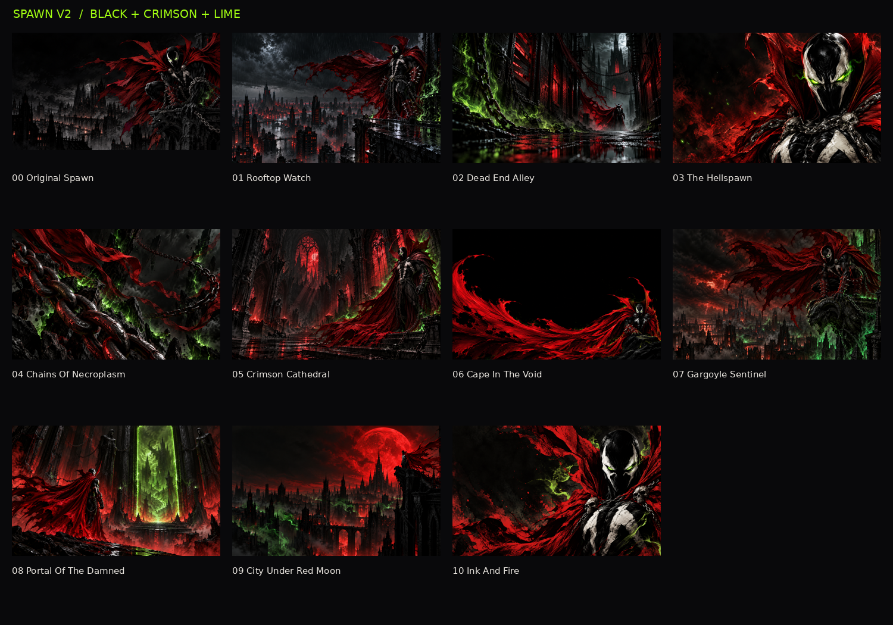

# Spawn — Omarchy theme

Ink-black surfaces, crimson accents, lime-green window borders, and eleven Spawn
wallpapers: ten new designs plus the original.



## Install through Omarchy

```bash
omarchy-theme-install https://github.com/jjwerline/omarchy-spawn-theme
```

Or use Install > Style > Theme in Omarchy and enter the repository URL.

## Update an existing Spawn theme

The included installer backs up your existing Spawn directory before replacing it:

```bash
git clone https://github.com/jjwerline/omarchy-spawn-theme ~/Downloads/omarchy-spawn-theme
bash ~/Downloads/omarchy-spawn-theme/install.sh
```

No sudo is required. The previous theme is preserved under
`~/.local/state/omarchy/theme-backups/`; its exact path is printed. Use `--no-apply`
to install without switching immediately. Run from your normal Omarchy account.

## Palette

| Element | Color |
| --- | --- |
| Background | `#09090B` |
| Crimson accent | `#E53945` |
| Active window border | `#A3FF12` |
| Inactive window border | `#548A0A` |
| Foreground | `#E8E4DE` |

Semantic Hyprland palette keys support current Omarchy; `hyprland.conf` provides
legacy theme colors. No global configuration, fonts, keybindings, or border widths
are changed. Omarchy generates supported application colors from `colors.toml`.

## Wallpapers

Run `omarchy-theme-bg-next` to cycle backgrounds.

00. Original Spawn
01. Rooftop Watch
02. Dead-End Alley
03. The Hellspawn
04. Chains of Necroplasm
05. Crimson Cathedral
06. Cape in the Void
07. Gargoyle Sentinel
08. Portal of the Damned
09. City Under Red Moon
10. Ink and Fire

The ten new PNGs are 1586 × 992; all are included at native resolution.

## Validation

Palette parsing, image integrity, archive integrity, installer syntax, fresh
installation, backup updates, and no-apply behavior were verified. Live desktop
appearance still needs testing on an Omarchy laptop. Local overrides can take
precedence over theme settings.

Unofficial AI-generated Spawn fan artwork; not affiliated with Spawn's rights
holders. No ownership of the Spawn character or trademarks is claimed.

Theme format: https://omarchy.org/manual/making-your-own-theme/
